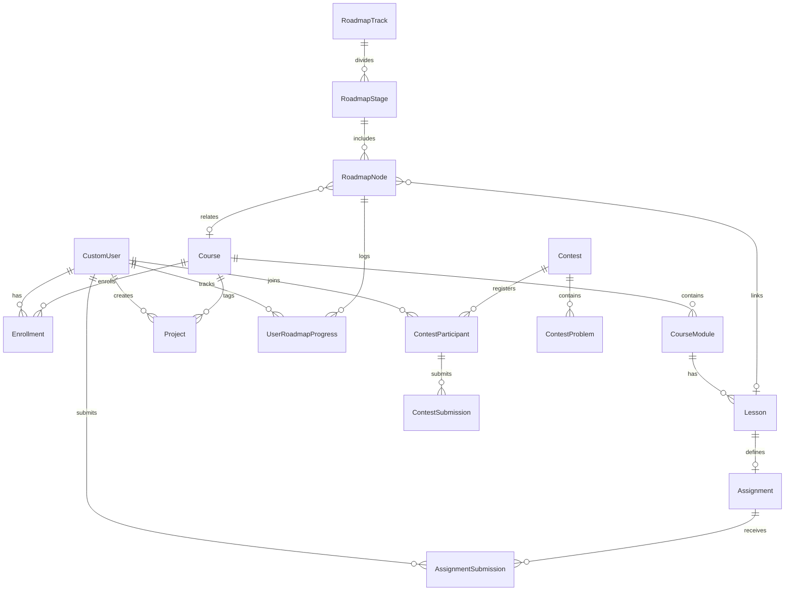

# RoziyevDev — O'quvchi Paneli (Student Portal) Texnik Amalga Oshirish Rejasi
## (Comprehensive Implementation Plan)

> **Hujjat turi:** Texnik Loyiha & Arxitektura Rejasi (Architecture & Implementation Blueprint)  
> **Platforma:** `roziyevdev` (Django 5, DRF, Tailwind CSS, PostgreSQL/SQLite)  
> **Maqsad:** O'quvchilar uchun shaxsiy rivojlanish, amaliy tajriba va o'zaro raqobat muhitini yaratuvchi to'laqonli O'quvchi Panelini (Student Dashboard) ishlab chiqish.

---

## 📑 Mundarija

1. [Loyiha Hozirgi Holati Tahlili (Codebase Audit & Gap Analysis)](#1-loyiha-hozirgi-holati-tahlili-codebase-audit--gap-analysis)
2. [O'quvchi Paneli Arxitekturasi va Marshrutlash (Portal Architecture & Routing)](#2-oquvchi-paneli-arxitekturasi-va-marshrutlash-portal-architecture--routing)
3. [1-Modul: Platformaning O'zida Vazifalarni Bajarish va O'qituvchiga Yuborish (Assignment Studio)](#3-1-modul-platformaning-ozida-vazifalarni-bajarish-va-oqituvchiga-yuborish-assignment-studio)
4. [2-Modul: Kurs Bo'yicha Jonli Reyting Tizimi (Course & Peer Leaderboard)](#4-2-modul-kurs-boyicha-jonli-reyting-tizimi-course--peer-leaderboard)
5. [3-Modul: Musobaqalar va Xakatonlar Bo'limi (Contests & Code Challenges)](#5-3-modul-musobaqalar-va-xakatonlar-bolimi-contests--code-challenges)
6. [4-Modul: Loyihalar Bo'limi va Talabalar Portfoliosi (Projects & Showcase)](#6-4-modul-loyihalar-bolimi-va-talabalar-portfoliosi-projects--showcase)
7. [5-Modul: «Dasturchi Yo'li» — Interaktiv Vizual Yo'nalish Xaritasi (Developer Roadmap)](#7-5-modul-dasturchi-yoli--interaktiv-vizual-yonalish-xaritasi-developer-roadmap)
8. [Ma'lumotlar Bazasi Modellari va Sxemalari (Database Schema & ORM)](#8-malumotlar-bazasi-modellari-va-sxemalari-database-schema--orm)
9. [REST API va URL Marshrutlar Xaritasi (API & Views Specification)](#9-rest-api-va-url-marshrutlar-xaritasi-api--views-specification)
10. [Frontend UI/UX va Komponentlar Standarti (Design System & Libraries)](#10-frontend-uiux-va-komponentlar-standarti-design-system--libraries)
11. [Bosqichma-bosqich Ish Rejasi va Taqsimoti (Step-by-Step Execution Plan)](#11-bosqichma-bosqich-ish-rejasi-va-taqsimoti-step-by-step-execution-plan)
12. [Xavfsizlik, Samaradorlik va Anti-Cheat Choralari](#12-xavfsizlik-samaradorlik-va-anti-cheat-choralari)

---

## 1. Loyiha Hozirgi Holati Tahlili (Codebase Audit & Gap Analysis)

### 1.1. Mavjud Komponentlar
Hozirgi platforma arxitekturasi tekshirilganda quyidagilar mavjudligi aniqlandi:
- **`apps/users`**: `CustomUser` (rollar: `student`, `instructor`, `admin`), `Profile`, `coins` (tanga balansi), JWT + Sessiya autentifikatsiyasi.
- **`apps/courses`**: `Category`, `Course`, `CourseModule`, `Lesson` (video, dars matni, yuklanmalar).
- **`apps/learning`**: `Enrollment`, `LessonProgress`, `Assignment`, `AssignmentSubmission`, `CoinTransaction`. Kurs pleeri (`player.html`) va o'qituvchining vazifalarni tekshirish stoli (`review_list.html`, `review_detail.html`).
- **`apps/dashboard`**: Faqat o'qituvchi va administratorlar uchun mo'ljallangan «Ustoz Studiyasi» (`@instructor_required`).
- **`apps/certificates`**, **`apps/orders`**, **`apps/blog`**, **`apps/core`**: Sertifikatlar, to'lovlar, maqolalar va landing page.

### 1.2. Aniqlangan Kamchiliklar va Yechilishi Kerak Bo'lgan Bo'shliqlar (Gaps)
1. **Talaba Paneli mavjud emas:** Oddiy talaba uchun alohida boshqaruv kabineti yo'q. Faqat `/profile/` statik sahifasi bo'lib, u yagona umumiy ma'lumotlar bilan cheklangan.
2. **Vazifalar tarqoq holatda:** Vazifa faqat dars pleeri ichida kichik forma sifatida mavjud. Barcha kurslar bo'yicha topshiriqlar holatini kuzatish, qaytarilgan vazifalarni qayta ishlash, platformaning o'zida qulay muharrirda kod yozish va natijani sinash markazlashtirilmagan.
3. **Reyting tizimi umuman yo'q:** Talaba o'zi o'qiyotgan kursdagi boshqa o'quvchilar bilan qanday natija ko'rsatayotganini, kurs reytingida nechanchi o'rinda ekanligini ko'ra olmaydi.
4. **Musobaqalar (Contests) mavjud emas:** Algoritmik yoki loyihaviy bellashuvlar, sovringa ega xakatonlar moduli platformada yo'q.
5. **Loyihalar (Projects) mavjud emas:** Kurs bitiruv amaliy ishlari (Capstone), talabalarning shaxsiy portfoliolari va jamoatchilik ko'rgazmasi yo'q.
6. **Dasturchi Yo'li (Roadmap) mavjud emas:** Talaba tanlagan yo'nalishi (masalan, Flutter, Python Backend) bo'yicha qaysi bekatlarni bosib o'tishi kerakligi va joriy progressi qayerda ekanligini vizual ko'rsatuvchi xarita mavjud emas.

---

## 2. O'quvchi Paneli Arxitekturasi va Marshrutlash (Portal Architecture & Routing)

O'quvchi paneli Ustoz Studiyasidan (`/dashboard/`) alohida, maxsus student-centric interfeys sifatida ishlab chiqiladi:

```
roziyevdev/
├── /student/                        -> O'quvchi Boshqaruv Markazi (Dashboard Overview)
├── /student/assignments/            -> Vazifalar Laboratoriyasi (Mening topshiriqlarim & Filtrlar)
├── /student/assignments/<id>/solve/ -> Platformada Vazifani Bajarish Muharriri (IDE / Studio)
├── /student/leaderboard/            -> Kurs va Guruh Reytingi (Kurs bo'yicha jonli Leaderboard)
├── /student/contests/               -> Musobaqalar Markazi (Faol, kutilayotgan va yakunlangan)
├── /student/contests/<slug>/        -> Musobaqa Xonasi & Masalalar
├── /student/projects/               -> Loyihalar Ko'rgazmasi & Mening Ishlarim
├── /student/projects/create/        -> Yangi Loyiha Yuklash Formasi
├── /student/roadmap/                -> «Dasturchi Yo'li» (Interaktiv Yo'nalish Xaritasi)
└── /student/roadmap/<track_slug>/   -> Aniq yo'nalish bo'yicha to'liq vizual xarita
```

### Navigatsiya Paneli (Sidebar) Tuzilmasi:
- 📊 **Boshqaruv Paneli** (Faollik, tezkor ko'rsatkichlar, joriy kurslar, tangalar balansi)
- 📝 **Vazifalar Markazi** (Topshiriqlar, kod muharriri, o'qituvchi taqrizlari)
- 🏆 **Kurs Reytingi** (Kursdoshlar reytingi, ligalar, eng yaxshi talabalar)
- ⚔️ **Musobaqalar** (Chempionatlar, xakatonlar, sovrinli topshiriqlar)
- 🚀 **Loyihalar** (Capstone loyihalar, portfolio, community showcase)
- 🗺️ **Dasturchi Yo'li** (Yo'nalish xaritasi, bosqichlar va progress)
- 📜 **Sertifikatlarim** (Tamomlangan kurslar rasmiy sertifikatlari)
- ⚙️ **Profil Sozlamalari** (Shaxsiy ma'lumotlar, ijtimoiy tarmoqlar)

---

## 3. 1-Modul: Platformaning O'zida Vazifalarni Bajarish va O'qituvchiga Yuborish (Assignment Studio)

### 3.1. Maqsad va Talablar
Talaba darsdagi amaliy topshiriqni boshqa joyga chiqmasdan, to'g'ridan-to'g'ri brauzerda bajarishi, kod yozishi, blok-sxema chizishi yoki zarur fayllarni biriktirib o'qituvchiga yuborishi kerak. O'qituvchi tekshirib qaytarsa, talaba shu zahoti tuzatib qayta topshirish imkoniga ega bo'lishi shart.

### 3.2. Funksional Imkoniyatlar
1. **Markazlashtirilgan Vazifalar Doskasi (`/student/assignments/`):**
   - Barcha yozilgan kurslardagi topshiriqlar jadvali.
   - Statuslar bo'yicha tezkor tablar:
     - `Barchasi`
     - `Bajarilishi kerak` (Hali topshirilmagan vazifalar)
     - `Tekshirilmoqda` (`pending` — Ustoz ko'rib chiqmoqda)
     - `Qayta ishlashga qaytarilgan` (`rejected` — Ustoz ko'rsatmasi bor)
     - `Qabul qilingan` (`approved` — Ball va tangalar berilgan)
   - Qidiruv va kurs bo'yicha filtrlash.

2. **Interaktiv Vazifa Studiyasi (`/student/assignments/<id>/solve/`):**
   - **Split-Screen Workspace:**
     - *Chap qatlam:* Vazifa sharti, yo'riqnoma, o'qituvchi talablari (Markdown qo'llab-quvvatlanadi), ball va mukofot tangalari.
     - *O'ng qatlam:* Kod muharriri, Blok-sxema generatori va Fayl yuklash zonasi.
   - **Zamonaviy Kod Muharriri (Monaco Editor / Ace Editor):**
     - Sintaksis yoritgich (Dart, Python, SQL, JS, HTML/CSS).
     - Qator raqamlari, avtomatik to'ldirish, qorong'i/yorug' rejim moslashuvi.
     - Shablon kodni tiklash (`Reset starter code`) tugmasi.
     - **Pre-flight Syntax Checker / Runner:** Kod sintaksisini tekshirish yoki frontend/Python kodini brauzerda sinab ko'rish imkoniyati.
   - **Blok-sxema (Flowchart) Rejimi:**
     - Mermaid.js orqali algoritmik blok-sxemalarni vizual chizish va jonli ko'rish (Live Preview).
   - **Biriktirilgan Fayllar (Dropzone):**
     - Loyiha arxivi (`.zip`, `.dart`, `.py`, `.pdf`, `.docx`) — 25 MB gacha xavfsiz yuklash.
   - **Topshirish Tugmasi:**
     - Bir marta bosish orqali ustoz tekshiruv stoliga (`apps/learning/review_views`) avtomatik jo'natish.

3. **O'qituvchi bilan Muloqot va Qayta Topshirish (Resubmission Flow):**
   - O'qituvchi taqrizi, qo'yilgan ball va tuzatish tavsiyalari alohida ajratilgan rangli blokda ko'rinadi.
   - Agar status `rejected` bo'lsa, "Kodni to'g'rilab qayta topshirish" tugmasi faollashadi.
   - Qabul qilinganda (`approved`): Tangalar balansi yangilanadi, ekranda konfetti animatsiyasi va tangalar ovozi yangraydi.

---

## 4. 2-Modul: Kurs Bo'yicha Jonli Reyting Tizimi (Course & Peer Leaderboard)

### 4.1. Maqsad va Talablar
Talaba faqat umumiy platforma emas, **aynan o'zi o'qiyotgan kursdagi guruhdoshlari orasidagi o'rnini** ko'rib tura olishi, bu esa sog'lom raqobat va o'rganishga bo'lgan qiziqishni oshirishi kerak.

### 4.2. Reyting Balini Hisoblash Algoritmi (Scoring Engine)
Kurs bo'yicha umumiy reyting bali quyidagi ko'p faktorli formula asosida hisoblanadi:

$$\text{Kurs Reyting Bali (XP)} = \sum(\text{Vazifalar Bali}) + (\text{Darslar Progressi \%} \times 5) + (\text{Kursdagi Mukofot Tangalari} \times 2)$$

- **Vazifalar Bali:** Qabul qilingan amaliy topshiriqlardan to'plangan haqiqiy ballar (har bir vazifa 100 ballgacha).
- **Progress Bali:** Kursdagi darslarni ko'rib tugatganlik ulushi (100% progress = +500 XP).
- **Faollik/Tangalar:** Darslarni o'z vaqtida topshirish va qo'shimcha rag'batlardan olingan bonuslar.

### 4.3. Foydalanuvchi Interfeysi (`/student/leaderboard/`)
1. **Kurs Selektori (Dropdown):**
   - Talaba o'zi a'zo bo'lgan kurslarni tanlaydi (Masalan: *«Flutter bilan Mobil Dasturlash»*, *«Python Backend Mutaxassisligi»*).
2. **Shaxsiy Pozitsiya Vidjeti (My Rank Card):**
   - "Sizning o'rningiz: **#4** / 128 nafar talaba orasida"
   - Keyingi o'rindagi talabadan qancha ball ortda qolayotgani: *"3-o'ringa chiqish uchun yana 25 ball kerak"*.
3. **Poydevor Shoxsupasi (Top 3 Podium):**
   - 🥇 1-o'rin (Oltin toj / kubok, avatar, to'plangan XP, tugatilgan vazifalar soni)
   - 🥈 2-o'rin (Kumush medal)
   - 🥉 3-o'rin (Bronza medal)
4. **Batafsil Reyting Jadvali:**
   - O'rin (#), Talaba (Avatar, Ism-familiya, mutaxassislik), Kursdagi progressi (ProgressBar), Topshirgan vazifalari soni, Umumiy to'plangan ball (XP), Tangalar.
   - Joriy foydalanuvchining o'z qatori yorqin ko'k ramka bilan alohida ajratib ko'rsatiladi.
5. **Filtrlar va Ligalar:**
   - Vaqt filtri: *Barcha vaqtlar*, *Shu oy*, *Shu hafta*.
   - Talabalar ligalari (Gamified Tiers):
     - 💎 **Diamond League** (Eng faol top 5%)
     - 🥇 **Gold League** (Keyingi 15%)
     - 🥈 **Silver League** (O'rta qatlam)
     - 🥉 **Bronze League** (Yangi boshlovchilar)

---

## 5. 3-Modul: Musobaqalar va Xakatonlar Bo'limi (Contests & Code Challenges)

### 5.1. Maqsad va Talablar
Talabalarning dasturlash ko'nikmalarini real vaqt rejimida sinash, haftalik/oylik musobaqalar va tematik xakatonlar o'tkazish, g'oliblarni tangalar va diplomlar bilan taqdirlash.

### 5.2. Arxitektura va Imkoniyatlar (`apps/contests`)
1. **Musobaqalar Turlari:**
   - **Algoritmik Challenge:** Muayyan vaqt oralig'ida (masalan, 2 soat) bir nechta masalalarni kodlash.
   - **Frontend / UI Challenge:** Berilgan dizayn yoki talab asosida Flutter/HTML interfeys yasash (2-3 kunlik).
   - **Weekend Hackathon:** Jamoaviy yoki yakkalik to'liq ishlovchi MVP loyiha topshirish (48 soatlik).

2. **Musobaqalar Vitrinasi (`/student/contests/`):**
   - **Faol Musobaqalar (Live Now):** Tugashiga qolgan vaqt jonli taymer (Countdown: `03h:42m:15s`), "Qatnashish" tugmasi.
   - **Kutilayotgan Musobaqalar (Upcoming):** Boshlanish sanasi, talablar, mukofot jamg'armasi, "Eslatib qo'yish" tugmasi.
   - **Yakunlangan Musobaqalar (Finished):** G'oliblar ro'yxati, saralangan yechimlar arxivi.

3. **Musobaqa Arenasi (`/student/contests/<slug>/`):**
   - Musobaqa qoidalari, baholash mezonlari va shartlari.
   - Masalalar mundarijasi (Problems list: A, B, C masalalar, har biriga beriladigan ballar).
   - Yechim topshirish formasi (Kod kiritish yoki repozitoriy havolasini yuborish).
   - **Jonli Natijalar Jadvali (Live Contest Leaderboard):** Har bir ishtirokchining masalalar bo'yicha yechgan natijalari va sarflagan vaqti.

4. **Mukofotlash Tizimi:**
   - 1-3 o'rin egalariga platforma tangachalari (`CoinTransaction` avtomatik kirim qilinadi).
   - G'oliblarga raqamli maxsus diplom / musobaqa sertifikati berilishi.

---

## 6. 4-Modul: Loyihalar Bo'limi va Talabalar Portfoliosi (Projects & Showcase)

### 6.1. Maqsad va Talablar
Nazariy bilim va kichik dars vazifalaridan tashqari, talaba **haqiqiy loyihalar (Portfolio / Capstone projects)** yaratishi, ularni platformada namoyish etishi, o'qituvchidan professional code review olishi va ish beruvchilarga ko'rsata oladigan raqamli portfolio hosil qilishi kerak.

### 6.2. Arxitektura va Imkoniyatlar (`apps/projects`)
1. **Uch Qatlamli Loyihalar Ekranlari (`/student/projects/`):**
   - **A. Mening Loyihalarim (My Projects):**
     - Talaba yuklagan barcha loyihalar kartochkalari.
     - Yangi loyiha qo'shish / tahrirlash / o'chirish.
     - Ustoz tekshiruvi holati (`Qoralama`, `Ko'rib chiqilmoqda`, `Tasdiqlangan & Nashr etilgan`).
   - **B. Kurs Bitiruv Loyihalari (Course Capstone Tasks):**
     - Kurs doirasida topshirilishi shart bo'lgan yirik loyihalar yo'riqnomasi (Masalan: *«To'liq funksional Yetkazib berish (Delivery) Flutter ilovasi»*).
     - Talablar, arxitektura namunalari, Figma maket havolasi.
   - **C. Talabalar Ko'rgazmasi (Community Showcase):**
     - Platformadagi eng yaxshi loyihalar galereyasi.
     - Yo'nalishlar bo'yicha filtrlash (Flutter, Backend, Web, Data).
     - Layklar, ko'rishlar soni, jonli Demo va GitHub kodiga to'g'ridan-to'g'ri o'tish imkoni.

2. **Loyiha Joylash Formasi (`/student/projects/create/`):**
   - Loyiha nomi va qisqa shiori.
   - Batafsil tavsif (Markdown yordamida: loyiha arxitekturasi, ishlatilgan kutubxonalar).
   - Ishlatilgan texnologiyalar steki (Masalan: `Flutter`, `BLoC`, `Django REST`, `PostgreSQL`).
   - GitHub ombori havolasi (GitHub URL).
   - Jonli demo havolasi (Play Store, TestFlight, Web URL, Telegram bot).
   - Skrinshotlar va Muqova rasmi (Thumbnail).
   - Qaysi kursga tegishli ekanligi (ixtiyoriy).

3. **O'qituvchi Taqrizi (Code Review & Grading):**
   - O'qituvchi loyiha kodini va demosi tekshirib, 100 ballik shkalada baholaydi va professional tavsiyalar qoldiradi.
   - Yuqori ball olgan loyihalar avtomatik ravishda "Sara Loyiha" (Featured Project) nishoniga ega bo'lib, bosh sahifada ko'rsatiladi.

---

## 7. 5-Modul: «Dasturchi Yo'li» — Interaktiv Vizual Yo'nalish Xaritasi (Developer Roadmap)

### 7.1. Maqsad va Talablar
O'quvchi o'z yo'nalishi (masalan, *Flutter Developer*, *Python Backend Developer*) bo'yicha professional darajaga chiqishi uchun qanday bilim va texnologiyalarni bosqichma-bosqich o'rganishi kerakligini chiroyli, interaktiv va tushunarli tarzda ko'rib turishi shart.

### 7.2. Vizual Konsepsiya va Foydalanuvchi Tajribasi (UI/UX)
- **Metro Liniyasi / Graf Daraxti Uslubi (Metro-line / Timeline Map):**
  - Chiroyli gradientli chiziqlar, bekatlar (nodes) va yo'nalish shoxchalari.
  - Har bir bekat rang kodiga ega:
    - 🟢 **Yashil (Tugallangan):** Talaba o'zlashtirgan mavzular (kurs darslari yakunlanganda avtomatik belgilanadi).
    - 🔵 **Ko'k & Pulsatsiyalanuvchi (Joriy bekat):** Talaba ayni paytda o'rganishi kerak bo'lgan navbatdagi bosqich.
    - ⚪ **Kulrang (Qulflangan / Kelgusi):** Hali yetib kelinmagan mavzular.
- **Yo'nalishlar (Tracks) Selektori:**
  - 📱 **Mobil Dasturchi Yo'li (Flutter & Dart)**
  - 🐍 **Backend Dasturchi Yo'li (Python, Django, PostgreSQL, Docker)**
  - 🧮 **Algoritmlar va Ma'lumotlar Tuzilmasi Yo'li**
  - 🌐 **Frontend Dasturchi Yo'li (HTML/CSS, JS, Vue/React)**

### 7.3. Bosqichlar va Bekatlar Tuzilmasi (Misol: Flutter Yo'nalishi)
```
[1-BOSQICH: Kompyuter Savodxonligi & Dasturlash Asoslari]
    ├── Algoritmlar & Mantiqiy Fikrlash
    └── Git & GitHub bilan Ishlash
           ↓
[2-BOSQICH: Dart Dasturlash Tili]
    ├── Dart Sintaksisi & Tiplar
    ├── OOP (Klasslar, Interfeyslar, Mixinlar)
    └── Asinxron Dasturlash (Futures, Streams)
           ↓
[3-BOSQICH: Flutter Framework Poydevori]
    ├── Flutter Widgetlar Daraxti (Stateless vs Stateful)
    ├── Responsive Dizayn & Layoutlar
    └── Navigatsiya & Routing
           ↓
[4-BOSQICH: Arxitektura & State Management]
    ├── Provider / Riverpod
    └── BLoC Pattern & Clean Architecture
           ↓
[5-BOSQICH: Tarmoq, Ma'lumotlar Bazasi & Xotira]
    ├── REST API (Dio, Retrofit)
    └── Offline Kesh (Hive, Isar, SQLite)
           ↓
[6-BOSQICH: CI/CD, Testlash & Nashr]
    ├── Unit & Widget Testlar
    └── Google Play & App Store ga chiqarish
```

### 7.4. Interaktiv Modal / Drawer Imkoniyatlari
Talaba xaritadagi istalgan bekatni bosganda o'ng tomondan panel chiqadi:
- **Mavzu mohiyati:** 2-3 jumlada nima uchun bu ko'nikma muhimligi.
- **Platformadagi Darslar:** RoziyevDev kurslaridagi aynan shu mavzuga tegishli darslar ro'yxati (bir marta bosish bilan darsga o'tish).
- **Tavsiya etilgan resurslar:** Rasmiy dokumentatsiya, maqolalar va cheat-sheetlar.
- **Progressni avtomatik sinxronlash:** Agar talaba bog'langan darsni ko'rib topshiriq topshirsa, ushbu bekat avtomatik «O'zlashtirildi» holatiga o'tadi.

---

## 8. Ma'lumotlar Bazasi Modellari va Sxemalari (Database Schema & ORM)

Yangi modellar va kengaytiriladigan mavjud jadvallar quyidagicha tuziladi:



### 8.1. Yangi Modellar Spetsifikatsiyasi

#### A. Musobaqalar Moduli (`apps/contests/models.py`)
```python
class Contest(TimeStampedModel):
    title = models.CharField(max_length=200)
    slug = models.SlugField(unique=True)
    category = models.CharField(max_length=50) # algorithmic, frontend, hackathon
    description = models.TextField() # Markdown
    banner = models.ImageField(upload_to='contests/banners/', blank=True, null=True)
    start_time = models.DateTimeField()
    end_time = models.DateTimeField()
    status = models.CharField(max_length=20, choices=[('upcoming', 'Kutilmoqda'), ('active', 'Davom etmoqda'), ('finished', 'Yakunlangan')])
    coin_prize_pool = models.PositiveIntegerField(default=1000)
    rules = models.TextField(blank=True)
    is_published = models.BooleanField(default=True)

class ContestProblem(TimeStampedModel):
    contest = models.ForeignKey(Contest, on_delete=models.CASCADE, related_name='problems')
    order = models.PositiveIntegerField(default=1)
    title = models.CharField(max_length=200)
    description = models.TextField()
    points = models.PositiveIntegerField(default=100)
    starter_code = models.TextField(blank=True)
    test_cases_input = models.TextField(blank=True)
    test_cases_expected = models.TextField(blank=True)

class ContestParticipant(TimeStampedModel):
    contest = models.ForeignKey(Contest, on_delete=models.CASCADE, related_name='participants')
    user = models.ForeignKey(CustomUser, on_delete=models.CASCADE, related_name='contest_entries')
    score = models.PositiveIntegerField(default=0)
    rank = models.PositiveIntegerField(null=True, blank=True)
    completed_at = models.DateTimeField(null=True, blank=True)

class ContestSubmission(TimeStampedModel):
    participant = models.ForeignKey(ContestParticipant, on_delete=models.CASCADE, related_name='submissions')
    problem = models.ForeignKey(ContestProblem, on_delete=models.CASCADE, related_name='submissions')
    submitted_code = models.TextField(blank=True)
    attached_file = models.FileField(upload_to='contests/submissions/', blank=True, null=True)
    score = models.PositiveIntegerField(default=0)
    status = models.CharField(max_length=20, default='pending') # pending, accepted, rejected
    reviewer_notes = models.TextField(blank=True)
```

#### B. Loyihalar Moduli (`apps/projects/models.py`)
```python
class Project(TimeStampedModel):
    author = models.ForeignKey(CustomUser, on_delete=models.CASCADE, related_name='projects')
    course = models.ForeignKey('courses.Course', on_delete=models.SET_NULL, null=True, blank=True, related_name='projects')
    title = models.CharField(max_length=200)
    slug = models.SlugField(unique=True)
    tagline = models.CharField(max_length=255)
    description = models.TextField() # Markdown
    thumbnail = models.ImageField(upload_to='projects/thumbnails/')
    tech_stack = models.CharField(max_length=300, help_text="Vergul bilan ajratilgan: Flutter, BLoC, Django, SQLite")
    github_url = models.URLField(blank=True, null=True)
    demo_url = models.URLField(blank=True, null=True)
    project_type = models.CharField(max_length=30, choices=[('capstone', 'Kurs bitiruv loyihasi'), ('personal', 'Shaxsiy loyiha'), ('open_source', 'Ochiq manbali')])
    status = models.CharField(max_length=20, default='under_review', choices=[('draft', 'Qoralama'), ('under_review', 'Tekshirilmoqda'), ('approved', 'Qabul qilingan'), ('featured', 'Sara loyiha')])
    score = models.PositiveSmallIntegerField(null=True, blank=True)
    instructor_review = models.TextField(blank=True)
    likes_count = models.PositiveIntegerField(default=0)
    views_count = models.PositiveIntegerField(default=0)

class ProjectLike(TimeStampedModel):
    user = models.ForeignKey(CustomUser, on_delete=models.CASCADE)
    project = models.ForeignKey(Project, on_delete=models.CASCADE, related_name='likes')
    class Meta:
        unique_together = ('user', 'project')
```

#### C. Dasturchi Yo'li Moduli (`apps/roadmaps/models.py`)
```python
class RoadmapTrack(TimeStampedModel):
    title = models.CharField(max_length=150) # Flutter & Dart, Python Backend...
    slug = models.SlugField(unique=True)
    icon = models.CharField(max_length=50, default='fa-solid fa-route')
    accent_color = models.CharField(max_length=50, default='blue')
    short_description = models.TextField(blank=True)
    estimated_months = models.PositiveSmallIntegerField(default=6)
    order = models.PositiveIntegerField(default=0)
    is_active = models.BooleanField(default=True)

class RoadmapStage(TimeStampedModel):
    track = models.ForeignKey(RoadmapTrack, on_delete=models.CASCADE, related_name='stages')
    title = models.CharField(max_length=200) # 1-Bosqich: Asoslar
    order = models.PositiveIntegerField(default=1)
    description = models.TextField(blank=True)

class RoadmapNode(TimeStampedModel):
    stage = models.ForeignKey(RoadmapStage, on_delete=models.CASCADE, related_name='nodes')
    title = models.CharField(max_length=200) # Dart Asinxronlik
    order = models.PositiveIntegerField(default=1)
    summary = models.TextField()
    is_essential = models.BooleanField(default=True)
    linked_course = models.ForeignKey('courses.Course', on_delete=models.SET_NULL, null=True, blank=True)
    linked_lesson = models.ForeignKey('courses.Lesson', on_delete=models.SET_NULL, null=True, blank=True)
    external_docs_url = models.URLField(blank=True, null=True)

class UserRoadmapProgress(TimeStampedModel):
    user = models.ForeignKey(CustomUser, on_delete=models.CASCADE, related_name='roadmap_progress')
    node = models.ForeignKey(RoadmapNode, on_delete=models.CASCADE, related_name='user_states')
    status = models.CharField(max_length=20, default='in_progress', choices=[('locked', 'Qulflangan'), ('in_progress', 'Jarayonda'), ('completed', 'Tugatildi')])
    completed_at = models.DateTimeField(null=True, blank=True)
    class Meta:
        unique_together = ('user', 'node')
```

---

## 9. REST API va URL Marshrutlar Xaritasi (API & Views Specification)

### 9.1. Web Sahifalar (Django Template Views)
| URL Marshruti | View Nomlanishi | Tavsifi va Vazifasi |
| :--- | :--- | :--- |
| `/student/` | `student_overview_view` | Talaba boshqaruv kabineti, umumiy statistika va tezkor amallar |
| `/student/assignments/` | `student_assignments_hub_view` | Barcha kurslar bo'yicha vazifalar filtri va ro'yxati |
| `/student/assignments/<int:assignment_id>/solve/` | `student_assignment_solve_view` | Platformaning o'zida vazifani bajarish (IDE & shablon muharriri) |
| `/student/leaderboard/` | `student_leaderboard_view` | Kurslar va platforma bo'yicha saralangan reyting jadvali |
| `/student/contests/` | `student_contests_list_view` | Musobaqalar ro'yxati (Faol, kutilayotgan, natijalar) |
| `/student/contests/<slug:slug>/` | `student_contest_detail_view` | Musobaqa shartlari, masalalar va jonli turnir jadvali |
| `/student/projects/` | `student_projects_view` | Mening loyihalarim, bitiruv ishlari va umumiy galereya |
| `/student/projects/create/` | `student_project_create_view` | Yangi loyiha qo'shish va havola kiritish formasi |
| `/student/roadmap/` | `student_roadmap_view` | «Dasturchi Yo'li» — Interaktiv yo'nalishlar xaritasi |
| `/student/roadmap/<slug:track_slug>/` | `student_roadmap_track_view` | Muayyan yo'nalish (masalan Flutter) to'liq metro xaritasi |

### 9.2. REST API Endpointlar (DRF)
| HTTP Metod | Endpoint | Ruxsat | Vazifasi |
| :--- | :--- | :--- | :--- |
| `GET` | `/api/v1/student/stats/` | `IsAuthenticated` | Talabaning umumiy ko'rsatkichlari, tangalari, reytingdagi o'rni |
| `GET` | `/api/v1/student/assignments/` | `IsAuthenticated` | Topshiriqlar ro'yxati (status, course filtrlari bilan) |
| `POST` | `/api/v1/student/assignments/<id>/submit/` | `IsAuthenticated` | Vazifa yechimini topshirish (kod, fayl, flowchart) |
| `GET` | `/api/v1/student/leaderboard/` | `IsAuthenticated` | Kurs bo'yicha reyting ma'lumotlari va talabaning pozitsiyasi |
| `GET` | `/api/v1/student/contests/` | `IsAuthenticated` | Musobaqalar ro'yxati va holati |
| `POST` | `/api/v1/student/contests/<id>/submit/` | `IsAuthenticated` | Musobaqa masalasiga yechim yuborish |
| `GET/POST` | `/api/v1/student/projects/` | `IsAuthenticated` | Loyihalar ro'yxati va yangi loyiha kiritish |
| `POST` | `/api/v1/student/projects/<id>/like/` | `IsAuthenticated` | Loyihaga layk bosish / qaytarib olish |
| `GET` | `/api/v1/student/roadmap/<slug>/` | `IsAuthenticated` | Yo'nalish xaritasi tugunlari va talaba progress holati |
| `POST` | `/api/v1/student/roadmap/node/<id>/toggle/`| `IsAuthenticated` | Roadmap bekatini qo'lda yakunlangan deb belgilash |

---

## 10. Frontend UI/UX va Komponentlar Standarti (Design System & Libraries)

Platformada mavjud bo'lgan zamonaviy dizayn tizimi (Tailwind CSS, Dark/Light Mode, Plus Jakarta Sans shrifti va Google Material Symbols) asosida ishlab chiqiladi:

1. **Yangi Asosiy Shablon (`templates/student/base_student.html`):**
   - Ustoz Studiyasi kabi chap tomonda ixcham va qulay yon menyu (Sidebar).
   - Mobil qurilmalarga to'liq moslashuvchan (Responsive Drawer & Hamburger menyu).
   - Yuqori qismida tangalar balansi animatsiyasi, bildirishnomalar qo'ng'irog'i, mavzuni o'zgartirish (Dark/Light).
2. **Kod Muharriri (Assignment IDE):**
   - CDN orqali **Monaco Editor** (VS Code muharririning brauzer yadrosi) yoki yengil **Ace Editor**.
   - Sintaksis yoritish: Python, Dart, SQL, JavaScript, HTML, CSS.
   - Tezkor tugmalar: `Formatlash`, `Shablonni tiklash`, `Yechimni yuborish`.
3. **Grafik va Sxemalar (Mermaid.js & Interactive SVG):**
   - Algoritmlar uchun Mermaid.js blok-sxemalari.
   - Roadmap uchun SVG va CSS Grid asosidagi chiroyli yo'l bekatlari (Nodes & Connecting Lines) va pulsatsiyalanuvchi nurlar effekti.
4. **Rag'batlantirish va Ovoz Effektlari (Gamification FX):**
   - Loyiha ichidagi mavjud `celebrateCoins()` Web Audio API mexanizmi orqali vazifa qabul qilinganda va reytingda ko'tarilganda tangalar jaranglashi va konfetti animatsiyasi.

---

## 11. Bosqichma-bosqich Ish Rejasi va Taqsimoti (Step-by-Step Execution Plan)

Reja 5 ta mantiqiy bosqichga ajratilgan bo'lib, har bir qism to'liq testlanib integratsiya qilinadi:

### 1-Bosqich: O'quvchi Paneli Poydevori va Navigatsiya (Student Shell)
- [ ] `apps/student` ilovasini yaratish va `INSTALLED_APPS` ga ro'yxatdan o'tkazish.
- [ ] `templates/student/base_student.html` shablonini ishlab chiqish (Sidebar, Header, Dark mode).
- [ ] `/student/` bosh sahifasini yaratish: xush kelibsiz banneri, joriy kurslar, tangalar balansi, umumiy statistika vidjetlari.
- [ ] `templates/base.html` bosh navigatsiyasida va profil menyusida talaba uchun ushbu panelga to'g'ridan-to'g'ri havolalarni joylashtirish.

### 2-Bosqich: Vazifalar Markazi va Onlayn Bajarish Studiyasi (Assignment Studio)
- [ ] `/student/assignments/` sahifasini qurish: barcha kurs topshiriqlarini holat bo'yicha saralash (`bajarilishi kerak`, `tekshirilmoqda`, `qaytarilgan`, `qabul qilingan`).
- [ ] `/student/assignments/<id>/solve/` interfeysini ishlab chiqish: Split-view shart va kod muharriri (Monaco/Ace editor integratsiyasi, starter code tiklash).
- [ ] O'qituvchiga yuborish mexanizmini bog'lash va mavjud `apps/learning` tekshiruv stoli (`dashboard/reviews/`) bilan uzluksiz sinxronlash.
- [ ] O'qituvchining bahosi va izohlarini ko'rsatish, qaytarilgan vazifani tahrirlab qayta jo'natish (Resubmission loop) imkonini yaratish.

### 3-Bosqich: Kurs va Guruh Reytingi Tizimi (Leaderboard Engine)
- [ ] Kurs bo'yicha XP va ballarni hisoblovchi servis (`calculate_course_leaderboard(course, timeframe)`).
- [ ] `/student/leaderboard/` sahifasini yaratish: o'zi o'qiydigan kurslar bo'yicha filtr, "Sizning o'rningiz" ko'rsatkichi.
- [ ] Top-3 talabalar shoxsupasi (Oltin, Kumush, Bronza podiumlari) va to'liq jadval interfeysi.
- [ ] Ligalar (Diamond, Gold, Silver, Bronze) tasnifini qo'shish.

### 4-Bosqich: Musobaqalar va Loyihalar Bo'limlari (Contests & Projects)
- [ ] `apps/contests` va `apps/projects` modellarini yaratish, admin panelga ulash va migratsiyalarni yurgizish.
- [ ] **Musobaqalar:**
  - `/student/contests/` vitrinasi (Faol, kutilayotgan, yakunlangan).
  - `/student/contests/<slug>/` musobaqa maydoni, masalalar sharti, topshirish va jonli reyting.
- [ ] **Loyihalar:**
  - `/student/projects/` sahifasi: "Mening loyihalarim", "Bitiruv loyihalari" va "Community Showcase".
  - `/student/projects/create/` yangi loyiha qo'shish formasi (GitHub, Live demo, rasm, texnologiyalar).
  - Layklar bosish va ustoz code review imkoniyatlari.

### 5-Bosqich: «Dasturchi Yo'li» — Interaktiv Vizual Xarita (Interactive Roadmap)
- [ ] `apps/roadmaps` modellarini yaratish (Track, Stage, Node, UserRoadmapProgress) va migratsiyalarni bajarish.
- [ ] Dastlabki yo'nalishlar ma'lumotlarini (Flutter & Dart, Python Backend, Algoritmlar) bazaga kiritish (Fixtures / Seed data).
- [ ] `/student/roadmap/` vizual metro xaritasini qurish (Chiroyli SVG/CSS nodelari, tugallangan, joriy va qulflangan bosqichlar).
- [ ] Bekat modalini ulash: mavzu tavsifi, platformadagi bog'liq kurs/darsga o'tish tugmasi va qo'shimcha havolalar.
- [ ] Talaba dars yoki topshiriqni tugatganda avtomatik ravishda roadmapdagi bekatni yashil rangga o'tkazish mantig'ini bog'lash.
- [ ] Tizimni to'liq integratsion testlash, xavfsizlik va responsivlik tekshiruvlarini yakunlash.

---

## 12. Xavfsizlik, Samaradorlik va Anti-Cheat Choralari

1. **Vazifalar Xavfsizligi:**
   - Yuklanadigan fayllar qat'iy tekshiriladi (ruxsat etilgan formatlar: `.zip`, `.pdf`, `.dart`, `.py`, `.sql`; maksimal hajm: 25 MB).
   - Xavfli skript va zararli fayl yuklanishining oldini olish uchun MIME-type tekshiruvi.
2. **Reyting va Musobaqalar Himoyasi (Anti-Cheat):**
   - Musobaqa vaqtida muddatdan keyin yuborilgan yechimlar rad etiladi.
   - Ballar va tangalar faqat backend orqali atomik tranzaksiyalar (`transaction.atomic`) bilan hisoblanadi.
3. **Kesh va Samaradorlik:**
   - Reyting hisob-kitoblari ko'p sonli o'quvchilar bo'lganda ma'lumotlar bazasini yuklamasligi uchun Django kesh tizimi (`django.core.cache`) yordamida har 5-15 daqiqada yangilanib keshlanadi.
4. **Xavfsiz Ruxsatlar (Permissions):**
   - Talabalar faqat o'zlari yozilgan kurslarning reytingini va topshiriqlarini to'liq ko'ra oladi.
   - O'qituvchilik imtiyozlari talabalarga ochilmaydi.

---

*Hujjat RoziyevDev ta'lim platformasi uchun maxsus tayyorlandi. Barcha bo'limlar bosqichma-bosqich to'liq amalga oshirilishi uchun tayyor holatda.*
